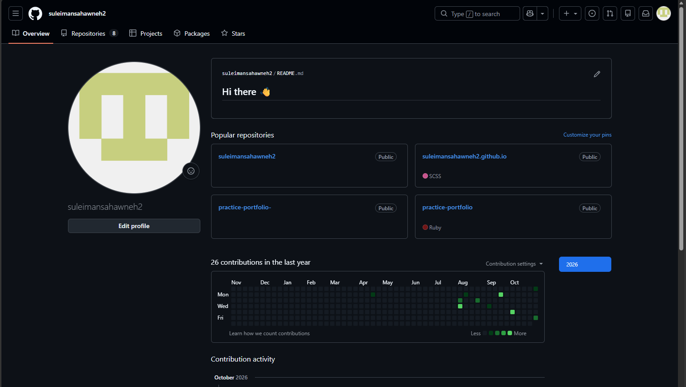
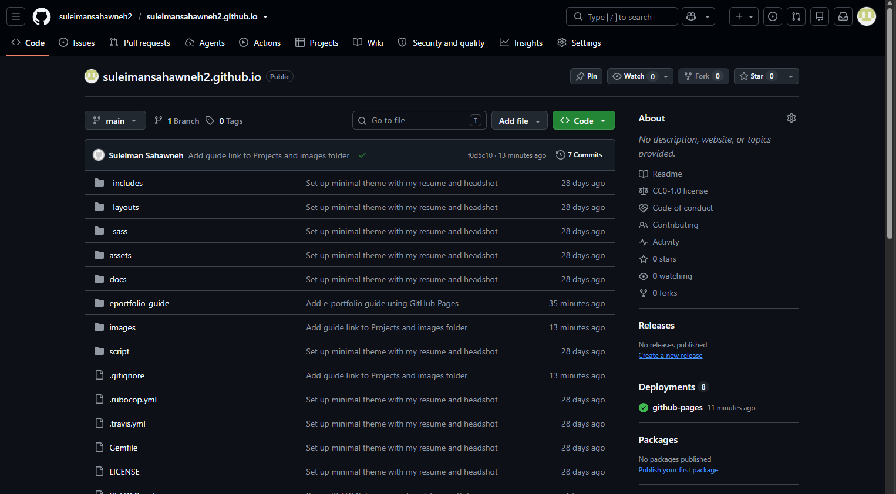
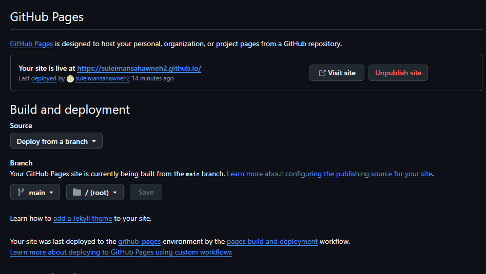
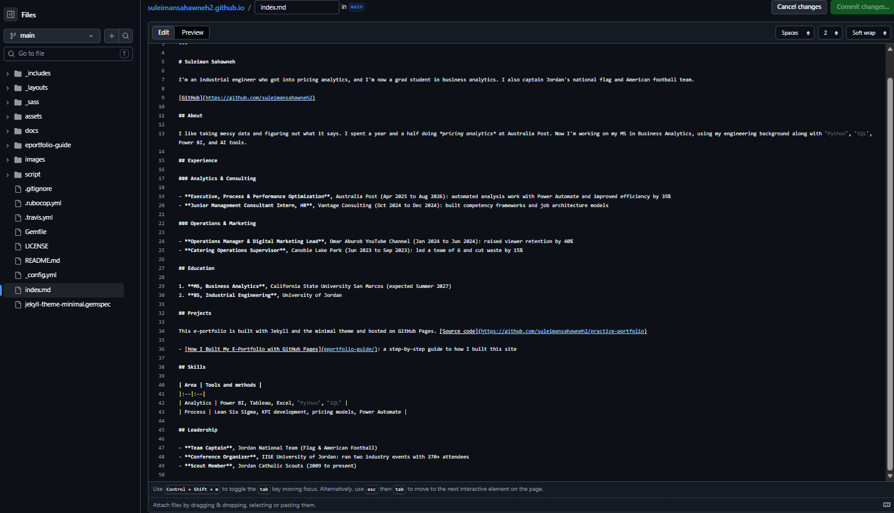
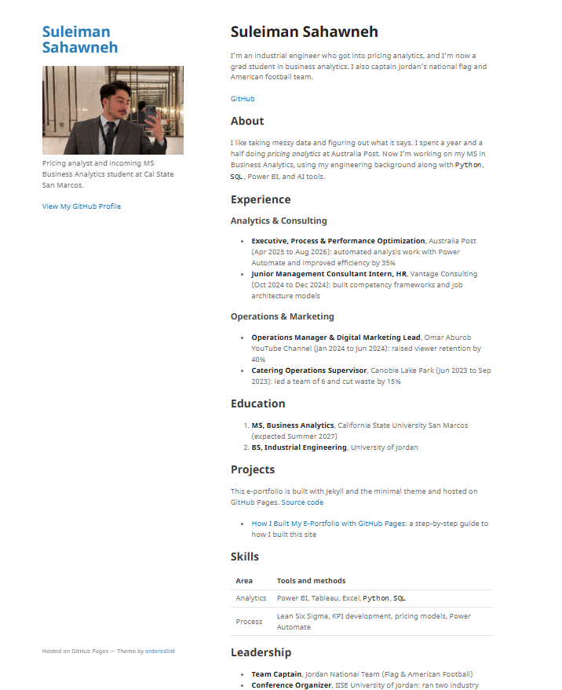

# How I Built My E-Portfolio with GitHub Pages

## Introduction
This guide explains how I built my e-portfolio for OSBA 620 using GitHub Pages and Markdown, from creating the repository to publishing the site I submitted for Milestone I.

## Step 1: Create a GitHub account
I signed up at [GitHub](https://github.com) with the username suleimansahawneh2.

## Step 2: Create the repository
GitHub Pages needs a public repository named after the username, so I created suleimansahawneh2.github.io.

## Step 3: Turn on GitHub Pages
In the repository I opened Settings, then Pages, and set the site to publish from the main branch.

## Step 4: Use the minimal theme
I used the [minimal theme](https://github.com/pages-themes/minimal) as the base design for the site.

## Step 5: Write my content in Markdown
I replaced the default placeholder content in index.md with my own portfolio content, using headers, lists, and links. I used the [Markdown cheat sheet](https://www.markdownguide.org/cheat-sheet/) from class as a reference.

### Changes I made to the base minimal theme
- Replaced the default placeholder text in index.md with my own content
- Added my headshot and a short bio in the sidebar
- Added sections for About, Experience, Education, Projects, Skills, and Leadership
- Added a Skills table
- Added a link to my GitHub profile

## Step 6: Commit my changes
Each time I edited a file, I committed the change to the main branch on GitHub. GitHub then rebuilt the site automatically.

## Step 7: Update the README
I replaced the default README.md text with my own portfolio information.

## Step 8: Check the live site
I opened https://suleimansahawneh2.github.io to confirm the changes appeared correctly.

## Final Result

## Resources
- [GitHub Pages documentation](https://docs.github.com/en/pages)
- [Jekyll minimal theme](https://github.com/pages-themes/minimal)
- [Markdown cheat sheet](https://www.markdownguide.org/cheat-sheet/)
- [VSCode Markdown preview](https://code.visualstudio.com/docs/languages/markdown#_markdown-preview)
